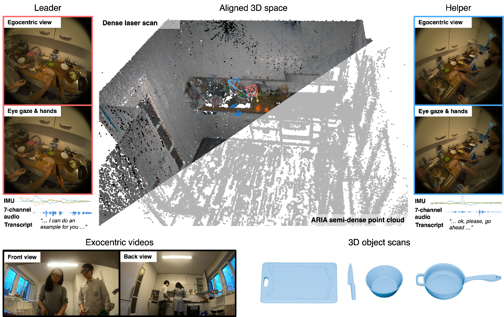
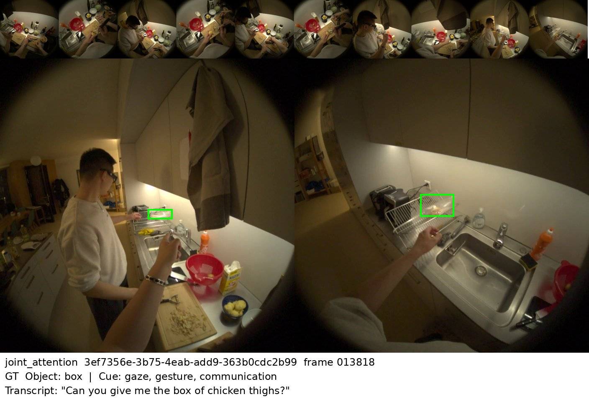
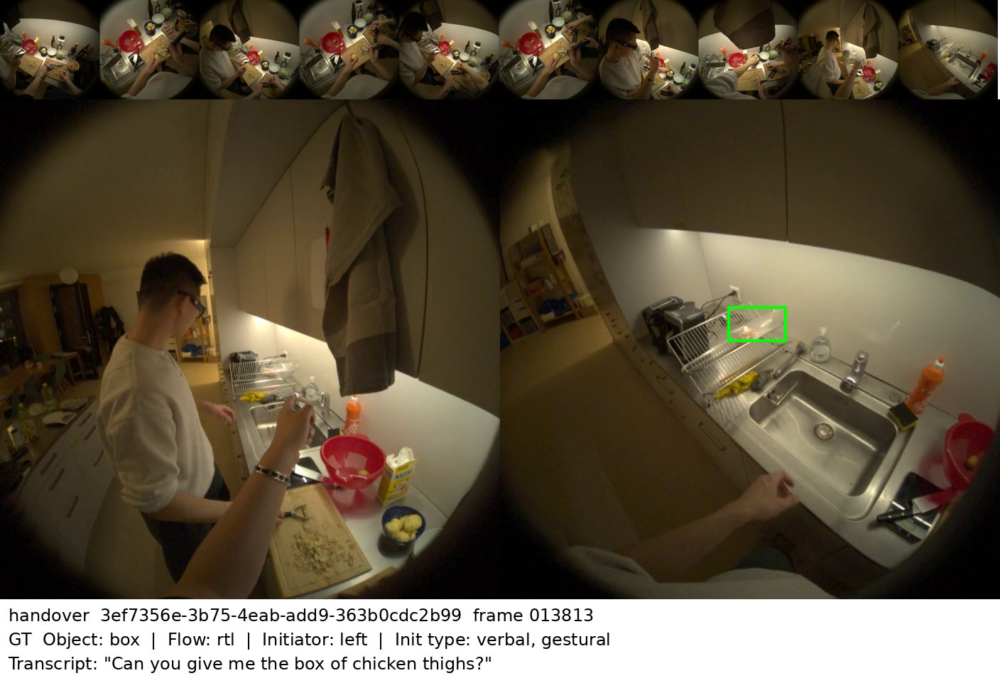
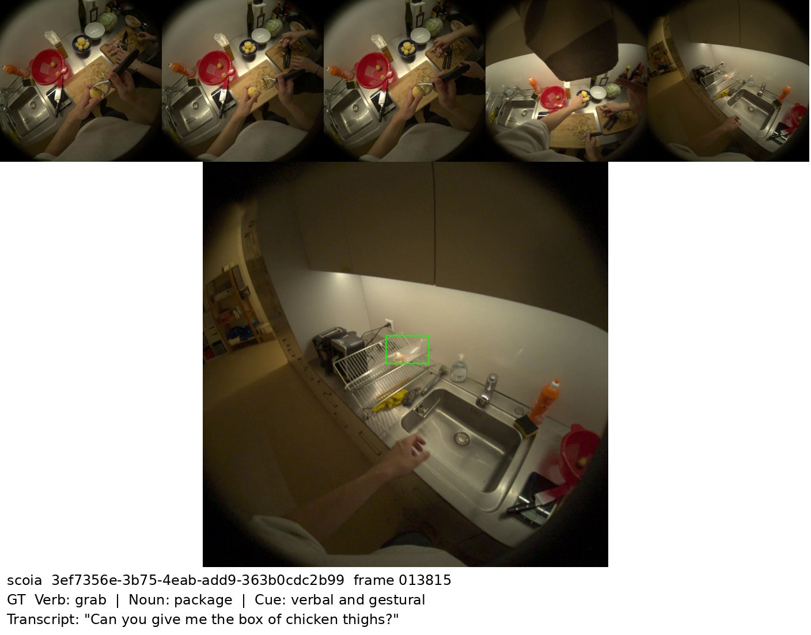

<div align="center">

<h1>CoMind: Understanding Collaborative Human Activity from Multiple Minds and Views</h1>

<p>
<a href="https://scholar.google.com/citations?user=BjEdv_AAAAAJ&hl=en">Alexey Gavryushin</a>*,
<a href="https://kristen-z.github.io/">Dingxi Zhang</a>*,
<a href="https://troyehuang.github.io/">Zhao Huang</a>*,
<a href="https://alexdelitzas.github.io/">Alexandros Delitzas</a>,
Jiaqi Chen,
Ben Ellis,
Cedric Zöllner,
<a href="https://manthan99.github.io/">Manthan Patel</a>,
<a href="https://manuelkaufmann.ch/">Manuel Kaufmann</a>,
<a href="https://people.inf.ethz.ch/marc.pollefeys/">Marc Pollefeys</a>,
<a href="https://xiwang1212.github.io/homepage/">Xi Wang</a>
</p>

<p><sup>*</sup>Equal contribution, Alphabetical Order</p>

<p><strong>ECCV 2026</strong></p>

<p>
<a href="https://arxiv.org/pdf/2607.06691"></a>
<a href="https://comind.ethz.ch/"></a>
</p>

<p align="center">
  
</p>

</div>

This repository contains the data loader, the VLM baselines (GPT, Claude, Gemini, Qwen-VL) and the evaluation for the three CoMind benchmarks. Each sample is a reference frame, the 10 s of video before it and the speech transcript of those 10 s.

| Task | Input | Prediction |
|---|---|---|
| Joint attention (`joint_attention`) | both egocentric views | cue types, object category, object box in each view |
| Handover prediction (`handover`) | both egocentric views | time to handover, direction, initiator, initiation cue, object category and box |
| Short-term cue → object interaction anticipation (`scoia`) | helper view | cue type, action verb, action noun, object box |

The same moment in all three tasks (GT boxes in green; the top row shows the preceding 10 s):

<details open>
<summary>Joint attention</summary>

</details>
<details>
<summary>Handover prediction</summary>

</details>
<details>
<summary>Short-term cue → object interaction anticipation</summary>

</details>

## Installation

```bash
git clone https://github.com/Kristen-Z/CoMind.git
cd CoMind
pip install -e ".[api]"    # GPT, Claude, Gemini
pip install -e ".[qwen]"   # Qwen-VL (local)
```

## Data

Download the annotations and recordings with the [download script](https://comind.ethz.ch/scripts/comind_download.py) from the project page, then cut the benchmark inputs (reference frames, 10 s clips and transcripts):

```bash
python comind_download.py test --parts annotations,mp4,transcripts --target data/comind
export COMIND_DATA_ROOT=data/comind
python -m comind.prepare --split test
```

Test annotations are held out; download and prepare `train` as well to evaluate locally.

```
data/comind/
├── annotations/
│   └── dataset_{joint_attention,handover,scoia}_consolidated.json   # test entries are null
├── split/
│   └── {train,test}.txt                                             # recording ids
├── recordings/<recording_id>/                                       # downloaded
│   ├── mp4s/helper_trimmed_sync.mp4                                 # helper view (SCOIA)
│   ├── mp4s/leader_helper_trimmed_sync.mp4                          # both views side by side
│   └── transcripts/helper_trimmed_sync_transcript.json
└── benchmark/<task>/                                                # written by comind.prepare
    ├── frames/<recording_id>/<frame_id>.jpg                         # reference frame
    ├── clips/<recording_id>/<frame_id>.mp4                          # preceding 10 s
    └── transcripts/<recording_id>.json                              # speech in the preceding 10 s
```

Each sample is identified by its recording id and the index of its reference frame (`frame_id`, 30 fps). Joint attention and handover frames are 1408×704 (two 704×704 views side by side); SCOIA frames are 1408×1408.

```python
from comind.data import CoMindDataset

ds = CoMindDataset("handover", split="train")
sample = ds[0]
frame = sample.load_frame()              # reference frame
clip = sample.load_context_frames(5)     # frames from the preceding 10 s
sample.transcript, sample.annotation, sample.gt_boxes()
```

`python -m comind.visualize --task handover --split train` draws samples as above; add `--pred_dir` to overlay a model's predictions.

## Baselines

```bash
export OPENAI_API_KEY=... ANTHROPIC_API_KEY=... GEMINI_API_KEY=...
python -m comind.infer --task handover --backend openai --model gpt-5.1
```

`--backend` is one of `openai`, `claude`, `gemini`, `qwen`. Joint attention uses the reference frame; handover and SCOIA additionally use 5 frames sampled uniformly from the preceding 10 s, identical for all models. Decoding is seeded with `--seed` (default 0) for Qwen-VL and Gemini; the OpenAI and Anthropic APIs do not support seeding.

The output directory (default `results/<task>/<model>/`) contains one raw model answer per sample, `<recording_id>_<frame_id>.txt`, and a `run_config.json`. Samples with an existing answer are skipped, so an interrupted run can be resumed.

To run all tasks:

```bash
bash scripts/run_baselines.sh test                                  # GPT, Claude, Gemini
sbatch scripts/slurm_qwen.sbatch Qwen/Qwen3-VL-8B-Instruct test     # Qwen-VL on a GPU node
```

## Evaluation

Submit test predictions through the [leaderboard](https://comind.ethz.ch/#leaderboards). The train split can be evaluated locally:

```bash
python -m comind.infer --task handover --backend openai --split train --output_dir results/train/handover/openai
python -m comind.evaluate --task handover --split train --pred_dir results/train/handover/openai
```

This prints the main metrics and writes `evaluation_results.json` (overall and per recording) to the prediction directory. The scripts above do both steps when called with `train`.

## Citation

```bibtex
@inproceedings{gavryushin2026eccv,
  author    = {Gavryushin, Alexey and Zhang, Dingxi and Huang, Zhao and Delitzas, Alexandros and Chen, Jiaqi and Ellis, Ben and Z{\"o}llner, Cedric and Patel, Manthan and Kaufmann, Manuel and Pollefeys, Marc and Wang, Xi},
  title     = {{CoMind}: Understanding Collaborative Human Activity from Multiple Minds and Views},
  booktitle = {Proceedings of the European Conference on Computer Vision (ECCV)},
  year      = {2026},
  publisher = {Springer}
}
```

## License

The code is released under the [MIT License](LICENSE). See the [project page](https://comind.ethz.ch/#license) for the dataset license.
